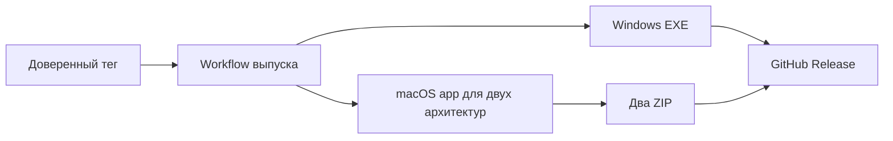

# Требования

### Результат
- Windows: скачиваемый релизный `finance-app.exe` запускается двойным щелчком без окна терминала.
- macOS: для Apple Silicon и Intel поставляется по одному приложению `FinanceApp.app`, запускаемому через Finder без терминала. Каждый `.app` распространяется внутри отдельного ZIP-архива: `.app` — каталог, и GitHub не может выдать его одним обычным файлом; после распаковки пользователь открывает приложение.
- Сборки публикуются напрямую в GitHub, отдельным процессом выпуска. Установщик не требуется.

### Ограничение доверия
Бесплатно, без действий пользователя и без подписи/публикации в магазине нельзя гарантировать отсутствие предупреждений на обеих системах. Подписывать и нотариализовать приложение, приобретать сертификаты, отключать защиту ОС или предлагать пользователю обход предупреждений не входит в задачу. На macOS и Windows системные предупреждения для неподписанных файлов могут оставаться.

# Технический план

### Текущее состояние
`crates/app/src/main.rs` запускает UI после настройки логов и базы. `.github/workflows/build.yml` собирает Windows EXE и архивы с исполняемыми файлами macOS, но не создаёт `.app` и не подписывает артефакты. `crates/app/Cargo.toml` уже содержит идентификатор пакета и путь к `assets/icons/icon.icns`; `installer/finance-app.nsi` использует тот же Windows EXE.

### Изменения
- В `crates/app/src/main.rs` добавить условный `windows_subsystem = "windows"` только для Windows release; debug и другие платформы не менять. У уже открытого терминала, например при `cargo run`, окно не исчезнет.
- На macOS создавать корректный bundle `FinanceApp.app`: `Contents/MacOS/finance-app`, `Contents/Info.plist` с идентификатором, именем, исполняемым файлом, типом приложения и версией, `Contents/Resources/icon.icns`. Упаковать через `ditto` в отдельные ZIP для arm64 и x86_64 с сохранением структуры и прав исполнения.
- Отдельный workflow выпуска для доверенного тега собирает Windows EXE и оба macOS bundle на соответствующих существующих раннерах, затем публикует эти три файла как вложения GitHub Release. Ограничить разрешения токена и не использовать секреты подписи; обычные проверки `.github/workflows/build.yml` остаются независимыми.
- Обновить раздел сборки и распространения в `README.md`: указать артефакты, распаковку macOS ZIP, запуск без терминала и отсутствие подписи/нотариализации.

### Файлы
- Изменить: `crates/app/src/main.rs`, `README.md`.
- Добавить: `.github/workflows/release.yml`; при необходимости шаблон `Info.plist` в `crates/app/`.
- Использовать без изменения: `assets/icons/icon.icns`, `crates/app/Cargo.toml`, `.github/workflows/build.yml`, `installer/finance-app.nsi`.

### Схема выпуска

### Риски
- Ошибки до инициализации журналирования и ошибки, возвращённые из `main`, после отключения консоли могут быть не видны пользователю; отдельный диалог ошибок не входит в этот объём.
- Условия Gatekeeper и SmartScreen зависят от ОС и репутации; наличие предупреждений не означает запуск терминала. Источники: [Apple Developer ID](https://developer.apple.com/developer-id), [Microsoft SmartScreen](https://learn.microsoft.com/en-us/windows/apps/package-and-deploy/smartscreen-reputation).

# Проверки

### Автоматические проверки
- Проверить `cargo fmt --all -- --check` и доступную сборку приложения; в Windows CI проверить по PE-заголовку, что release использует GUI subsystem, а debug сохраняет console subsystem.
- На каждом macOS runner проверить структуру `.app`, `Info.plist`, наличие и права бинарника и иконки; распаковать итоговый ZIP и повторить проверки. Проверить, что выпуск с��держит EXE и два отдельных macOS ZIP.

### Проверка запуска
- При наличии Windows GUI запустить скачанный release EXE двойным щелчком и проверить окно приложения и отсутствие консоли.
- При наличии macOS GUI скачать ZIP через браузер, распаковать и запустить `.app` через Finder на каждой доступной архитектуре; зафиксировать системные предупреждения отдельно от факта запуска терминала.
- Если графический запуск или платформа недоступны, явно сообщить, что проверено только структурно; не объявлять сценарий фактически проверенным.

# Delivery Steps

### ✓ Step 1: Отключить консоль Windows в release
Релизный Windows EXE использует GUI subsystem и не создаёт консоль при запуске двойным щелчком.
- Изменить атрибут crate в `crates/app/src/main.rs`, сохранив console subsystem для debug.
- Проверить PE subsystem release и debug на Windows и при доступном GUI проверить фактический запуск.

### ✓ Step 2: Подготовить macOS приложения
Для каждой поддерживаемой архитектуры собирается самостоятельный `FinanceApp.app` в ZIP.
- Создать bundle с `Info.plist`, исполняемым файлом и существующей иконкой, используя текущие macOS runner-конфигурации.
- Проверить содержимое и права после упаковки и распаковки; при доступном GUI проверить запуск через Finder.

### ✓ Step 3: Опубликовать отдельный GitHub Release
Доверенный выпуск публикует один Windows EXE и два ZIP с приложениями macOS.
- Добавить отдельный `.github/workflows/release.yml` для запуска по тегу и публикации релизных вложений с минимальными разрешениями.
- Сохранить обычный CI отдельно и проверить полный набор артефактов.
- Обновить `README.md`, указав способ запуска и неизбежные ограничения неподписанных сборок.