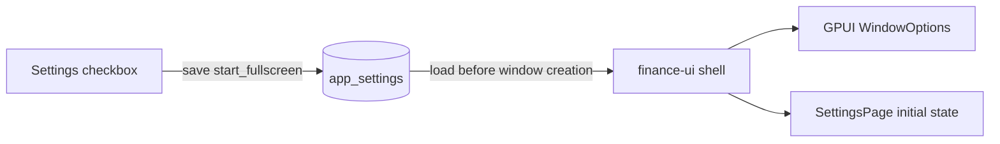

# Requirements

### Overview & Goals
Добавить на страницу «Настройки» чекбокс «Открывать приложение в полноэкранном режиме». Сохранённое значение определяет режим главного окна при следующем запуске приложения.

### Scope
- Добавить булеву настройку в существующую таблицу `app_settings`; новое значение по умолчанию — `false`, то есть запуск в оконном режиме.
- Сохранять переключение чекбокса сразу через существующий API настроек.
- Не менять уже открытое окно при переключении; выбор применяется при последующем запуске.
- Не добавлять миграцию схемы или новые зависимости.

# Technical Design

### Current Implementation
- `crates/ui/src/gpui/settings.rs` уже загружает и сохраняет предпочтение темы через `finance_db::get_app_setting` и `finance_db::set_app_setting`; страница использует `gpui-kit` и управляет собственным состоянием.
- В `crates/ui/src/gpui/directories.rs` есть действующий шаблон `Checkbox::new(...).checked(...).on_click(...)`.
- `crates/ui/src/gpui/shell.rs::run` формирует `WindowOptions` и создаёт главное окно через `open_window`; минимальный размер окна — 1280×720.
- Таблица `app_settings` с произвольными парами `key`/`value` создана миграцией `crates/db/migrations/V1__initial.sql`, а чтение и upsert доступны в `crates/db/src/lib.rs`.

### Key Decisions
- Хранить настройку под ключом `start_fullscreen` со значениями `true` и `false`; отсутствие значения трактовать как `false`.
- Загрузить настройку в `finance-ui` до формирования параметров окна и передать разрешённое значение в `SettingsPage`, чтобы окно и чекбокс отражали одно состояние без повторного чтения.
- Использовать штатные параметры границ/состояния окна GPUI для полноэкранного старта; при выключенной настройке сохранить текущий оконный запуск.
- При ошибке чтения безопасно запускать окно в оконном режиме и сообщить об ошибке в настройках; при ошибке записи не показывать несохранённое значение как сохранённое.

### Proposed Changes
- В `crates/ui/src/gpui/settings.rs` добавить состояние `start_fullscreen`, отобразить русскоязычный `Checkbox` и сохранять новое значение через `set_app_setting`.
- В `crates/ui/src/gpui/shell.rs` прочитать предпочтение до создания `WindowOptions`, выбрать полноэкранный или обычный режим окна и передать значение в конструктор `SettingsPage`.
- Использовать существующие `get_app_setting` / `set_app_setting` из `crates/db/src/lib.rs`; схема базы и `crates/app/src/main.rs` не меняются.

### Architecture Diagram

# Testing

### Validation Approach
- Покрыть преобразование сохранённых значений и поведение по умолчанию: `true` включает полноэкранный старт; отсутствие настройки и `false` оставляют оконный режим.
- Проверить сохранение и последующее чтение нового ключа через существующий DB API на временной тестовой базе.
- Запустить `cargo fmt --all -- --check`, `cargo check --workspace --all-targets --locked` и `cargo test --workspace --locked`; платформенный запуск окна на Windows отдельно не заявлять как проверенный, если он фактически не выполнен.

# Delivery Steps

### Stage 1: Add persisted fullscreen preference to SettingsPage
Страница «Настройки» показывает сохранённое состояние чекбокса и записывает его при переключении.
- Добавить в `crates/ui/src/gpui/settings.rs` состояние настройки и checkbox по существующему шаблону GPUI Kit.
- Сохранять `true`/`false` под ключом `start_fullscreen` через `finance_db::set_app_setting`; при ошибке сохранить прежнее состояние интерфейса и показать сообщение.
- Считать отсутствующую настройку выключенной; покрыть чтение/запись и значение по умолчанию тестами, используя тестовую БД для DB-проверки.

### Stage 2: Apply the preference when creating the main window
Главное окно запускается в сохранённом режиме, а чекбокс отображает то же значение.
- В `crates/ui/src/gpui/shell.rs::run` прочитать `start_fullscreen` до создания `WindowOptions`.
- Использовать поддерживаемое GPUI состояние полноэкранного окна, сохранив оконный режим по умолчанию и минимальный размер 1280×720.
- Передать загруженное значение в `SettingsPage`, обработать некорректное/недоступное значение безопасным оконным режимом и проверить сборку и тесты workspace.