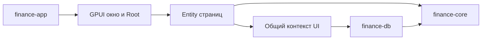

# Требования

### Цель
Заменить `eframe`/`egui` на нативный `gpui-kit = "0.10.0"`, сохранив семь существующих вкладок, сценарии работы, финансовую семантику и пользовательские данные.

### Границы
- Перенести текущие формы, таблицы, фильтры, итоги, темы, диаграммы и импорт/экспорт SQLite, включая подтверждения и сообщения об ошибках.
- Сохранить русскоязычный интерфейс, работу офлайн и доступность действий при 1280×720.
- Не менять схему БД, миграции, финансовые формулы и не добавлять новые форматы экспорта или банковские расчёты.
- Это план дальнейших работ; реализация, Windows-сборка и проверки совместимости ещё не выполнены.

# Технический дизайн

### Текущее состояние и решения
- `finance-ui` напрямую вызывает `finance-db`; в `lib.rs` объект `FinanceApp` объединяет соединение, общее состояние и `eframe::App::update`. `SavingsPage`, `PaymentDocumentsPage` и `AnalysisPage` уже содержат состояние отдельных страниц.
- Выбранное решение: отдельные состояния/GPUI `Entity` страниц и небольшой общий контекст с доступом к существующим функциям БД; новый слой сервисов и изменения `finance-core`/`finance-db` без необходимости не вводятся.
- Использовать обычный backend `gpui-kit` с компонентами и ресурсами по умолчанию, без `gpui-fast` и прямой зависимости от другого GPUI. По документации 0.10.0 запуск использует `application()`, `init` и `open_window`, создающий `Root` для диалогов и уведомлений. Проверить реальные системные зависимости, версию Rust и совместимость Windows 10/11; локальный Rust 1.100.0 сам по себе не подтверждает сборку.
- Временно размещать новые страницы рядом со старыми, не запускать оба UI одновременно; переключить точку входа после переноса всех сценариев, затем убрать `eframe`.

### Изменяемые файлы
- `Cargo.toml`, `crates/ui/Cargo.toml`, `Cargo.lock`: добавить `gpui-kit = "0.10.0"`, разрешить зависимости, после переключения удалить `eframe`; сохранить `rfd` при совместимости нативных диалогов.
- `crates/ui/src/lib.rs` и новый каталог `crates/ui/src/gpui/`: запуск, корневое окно, навигация, общее состояние и страницы GPUI; после переключения удалить устаревшие реализации `egui` без потери независимой логики.
- `common.rs`, `date_input.rs`, `category_tree.rs`: перенести общие фильтры, итоги, календарь и дерево категорий; сохранить ввод дат, кириллицу и смысл цветовых маркеров.
- `income_page.rs`, `expense_page.rs`, `transactions_page.rs`, `directories_page.rs`: перенести операции и справочники, их формы, фильтры и действия.
- `savings_page.rs`, `payment_documents_page.rs`: перенести состояния вкладов и карт, формы, связи, постраничное отображение и подтверждения.
- `analysis_page.rs`: перенести фильтры, отчёт, диаграммы и асинхронную загрузку со счётчиком поколений; не допускать перезаписи результатов новыми фильтрами устаревшими запросами.
- `settings_page.rs`, `crates/app/src/main.rs`: перенести темы, нативные диалоги и фоновые операции резервной копии; адаптировать жизненный цикл импорта. Проверить возможность повторного открытия окна в одном цикле GPUI: перед восстановлением закрыть все соединения и завершить фоновые операции, восстановить через существующий `finance-db`, затем открыть обновлённую БД; при невозможности безопасного повторного открытия использовать проверенный перезапуск процесса. Не копировать открытую БД обычным файловым копированием.
- `docs/architecture.md`, `docs/decisions.md`, `README.md`: обновить фактическую архитектуру, решение о UI и инструкции сборки/платформенные зависимости.

### Взаимодействие

### Риски
- Отрисовка `egui` и тесты `egui::Context` не переносятся автоматически: заменить UI-зависимые проверки на тесты GPUI и независимые тесты поведения, не удаляя покрытие.
- Текущая пагинация вкладов и карт ограничивает отображение, но предварительно загружает весь набор; новая виртуализация сама по себе не гарантирует 1 секунду на 100 000 записей. Измерить отдельно и при необходимости согласовать минимальные изменения запросов.
- Проверить доступность компонентов, поддержку русского ввода, DPI/шрифтов, системной темы и клавиатуры на целевой Windows; не утверждать их работоспособность без фактической проверки.

# Проверки

### Сценарии
- Тесты состояния и интерфейса для семи вкладок: CRUD, поиск, фильтры, точные итоги, валидация, удаление и несохранённые изменения; сохранить существующие проверки бизнес-правил и SQLite.
- Аналитика: переключение фильтров во время загрузки, пустые данные, диаграммы и раздельные валюты; поздний ответ не заменяет актуальный.
- Настройки: сохранение темы после перезапуска, создание и открытие снимка, подтверждённый импорт, отказ и ошибки; исходная БД остаётся доступной при неуспехе.
- Проверить 1280×720, прокрутку широких таблиц, русский текст, клавиатуру и форматы; на синтетических 100 000 записях замерить открытие и фильтрацию в release-сборке с указанием окружения.
- Запустить `cargo fmt --all -- --check`, `cargo check --workspace --all-targets --locked`, `cargo clippy --workspace --all-targets --locked -- -D warnings`, `cargo test --workspace --locked`, `cargo build -p finance-app --release --locked`; проверить сборку и запуск на Windows 10/11 x64 при наличии окружения, отдельно зафиксировать недоступные проверки.

# Delivery Steps

### ✓ Step 1: Подготовить GPUI и каркас страниц
Новый GPUI-каркас запускается отдельно от текущего интерфейса и предоставляет общие компоненты.
- Добавить `gpui-kit` в workspace и `finance-ui`, обновить `Cargo.lock`; сохранить старый запуск до переключения.
- Создать корневое окно, навигацию, состояния страниц и общий контекст в `crates/ui/src/gpui/`.
- Перенести общие компоненты из `common.rs`, `date_input.rs` и `category_tree.rs`, включая русскоязычный календарь.
- Проверить минимальное окно, состояние ввода, навигацию, зависимости и начальную Windows-совместимость.

### * Step 2: Перенести операции и справочники
Доходы, расходы и справочники доступны через страницы GPUI с прежними операциями.
- Перенести поведение `income_page.rs`, `expense_page.rs`, `transactions_page.rs` и `directories_page.rs`.
- Сохранить фильтры, категории, валюты, подсказки комментариев, точные итоги и подтверждения удаления.
- Перенести соответствующие тесты поведения и добавить проверки форм, таблиц и границ дат.

###   Step 3: Перенести накопления и платёжные карты
Страницы накоплений и карт сохраняют существующие формы, фильтры и связи.
- Перенести `savings_page.rs` и `payment_documents_page.rs`, включая пагинацию, предупреждения и подтверждение несохранённых изменений там, где оно существует.
- Сохранить транзакционные операции и ограничения связей одного банка через существующие функции БД.
- Проверить CRUD, смену банка, фильтрацию, ошибки и сохранение точных значений.

###   Step 4: Перенести аналитические отчёты
Анализ отображает актуальный отчёт и диаграммы в GPUI.
- Перенести `analysis_page.rs`, фильтры, состояния загрузки и ошибки, таблицы и диаграммы.
- Сохранить фоновое чтение и защиту поколениями от устаревших результатов.
- Проверить смену фильтров при загрузке, пустые отчёты и раздельные валюты.

###   Step 5: Перенести настройки и переключить приложение
Приложение использует только GPUI, а импорт и экспорт базы сохраняют прежнюю безопасность.
- Перенести `settings_page.rs`: темы, файловые диалоги, фоновые операции и подтверждения.
- Адаптировать `crates/app/src/main.rs` для безопасного освобождения соединений, восстановления и повторного запуска окна либо процесса; проверить отказ и восстановление.
- Переключить `finance_ui::run`, удалить устаревшие реализации и зависимости `eframe`, обновить документацию и зафиксировать принятое решение.
- Выполнить доступные проверки workspace, сценарии семи вкладок, замеры release на синтетических данных и проверки Windows; явно сообщить о пропущенных проверках.