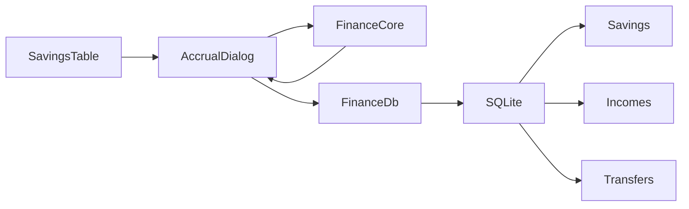

# Requirements

### Цель
На странице «Накопления» добавить действие для изменения сведений о выплате процентов и, по выбору пользователя, создать обычный доход с указанным получателем.

### Функциональные требования
- В группе «Выплата процентов» добавить отдельную колонку с компактной кнопкой `Inspector`, визуально соответствующей действию «Следующий платёж» на странице платёжных карт. Кнопка доступна для каждой записи накопления.
- Диалог позволяет изменить дату начисления процентов и существующее поле «Место начисления процентов».
- Флажок «Сформировать доход» раскрывает обычную форму дохода: дата дохода, сумма, валюта, активная категория дохода, получатель и комментарий.
- Сумма по умолчанию — текущая сумма накопления × выбранная ставка / 100, без учёта дат; результат округляется до сотых. Пользователь может отредактировать сумму.
- Если задана повышенная ставка, показывать флажок «Условия для повышенного процента выполнены». Переключение пересчитывает сумму, пока она автоматическая; введённая вручную сумма сохраняется. Флажок является подтверждением пользователя, а не автоматической проверкой условий.
- Получатель дохода: подходящая дебетовая карта, «Без карты» или текущее накопление. Доход на карту использует существующее изменение баланса; без карты создаётся только запись дохода; для накопления создаются запись дохода и отдельное пополнение `top_up`.
- Доход и пополнение используют выбранную дату дохода. При получателе-накоплении его валюта должна быть заранее задана и совпадать с валютой дохода; приложение не назначает валюту автоматически.
- Сохранение даты/места и всех выбранных финансовых записей выполняется атомарно. Без флажка создания дохода баланс и журналы доходов/переводов не меняются.

### Ограничения
- Формула — пользовательски согласованное значение по выбранной ставке, а не подтверждение фактического расчёта банка. Не добавлять капитализацию, расчёт за период или автоматическую проверку повышенных условий.
- Использовать существующие сущности доходов, накоплений и переводов; новую схему и миграцию не добавлять.

# Technical Design

### Текущее устройство и паттерны
- `finance-ui` напрямую обращается к `finance-db`; доменные типы и точные суммы находятся в `finance-core`.
- В `crates/ui/src/gpui/payment_documents.rs` действие следующего платежа использует фиксированную колонку шириной 40 pt и кнопку `Button::xsmall().icon(IconName::Inspector)`. Диалог раскрывает форму расхода с категорией, суммой, валютой, картой и отдельной датой.
- В `crates/ui/src/gpui/savings.rs` таблица уже группирует дату и назначение процентов под «Выплата процентов». Ставки и суммы хранятся как `Decimal`; ключ ширин колонок сейчас `table_columns.savings.v3`.
- `finance-db::save_next_payment` уже объединяет изменение даты и необязательную операцию в транзакции. Доход на дебетовую карту корректирует её баланс атомарно. `save_transfer` отдельно ведёт журнал переводов и баланс накопления; `top_up` не записывается как доход.
- `docs/decisions.md` и `docs/architecture.md` сейчас фиксируют, что начисление процентов не рассчитывается, а дата является справочной; их описание потребуется актуализировать.

### Ключевые решения
- Расчёт вынести в `finance-core`: точная арифметика `Decimal`, округление до двух знаков существующей стратегией `MidpointAwayFromZero`; даты не участвуют. Повышенная ставка используется только при подтверждённом пользователем флажке.
- Сохранить принятую модель «доход плюс пополнение»: обычный доход виден в анализе, а изменение баланса накопления — отдельной записью перевода. Последующие изменения этих двух записей не синхронизируются автоматически.
- Если доход зачисляется на накопление с неизвестной валютой, отклонять операцию с понятным сообщением и предложением сначала настроить валюту накопления.
- Дата начисления — сохраняемое справочное поле накопления; дата самого дохода — отдельное поле, первоначально равное выбранной дате начисления.
- Новая форма следует `docs/form-guidelines.md`; визуально повторяет только компактный шаблон кнопки из платёжных карт.

### Изменения по файлам
- `crates/core/src/lib.rs`: добавить типизированную функцию расчёта значения по умолчанию с проверенной арифметикой и тестами базовой/повышенной ставки, точности и округления.
- `crates/db/src/lib.rs`: добавить единый API начисления, который обновляет дату и назначение процентов, создаёт доход при наличии формы и при выборе текущего накопления создаёт `top_up`. Переиспользовать общую транзакцию; при необходимости выделить внутреннюю версию сохранения перевода, чтобы не открывать вложенную транзакцию. Ошибка любого шага откатывает всё.
- `crates/ui/src/gpui/savings.rs`: добавить колонку действия, состояние и диалог формы; связать расчёт, категории/валюты/карты и DB API. Увеличить группу «Выплата процентов» на кнопку, обновить индексы/ширины, перейти на ключ `table_columns.savings.v4` и сохранить значения старых настроек `v3`.
- `docs/decisions.md`, `docs/architecture.md`: описать утверждённую формулу, пользовательский статус повышенной ставки, модель «доход плюс пополнение» и новую функцию.
- `crates/db/migrations/`: без изменений — используются существующие таблицы доходов и переводов.

### Поток данных

# Testing

### Проверки
- `finance-core`: базовая и повышенная ставка, округление до сотых, сохранение Decimal-точности и обработка недопустимого/переполняющего значения.
- `finance-db`: дата и поле назначения сохраняются вместе; создание только дохода, дохода на карту и дохода с `top_up` для текущего накопления; совпадение валют; откат даты, дохода, перевода и баланса при ошибке любого шага; неизвестная валюта накопления не приводит к неявному зачислению.
- `finance-ui`: действие появляется в каждой строке; группа заголовка и фиксированная ширина колонки корректны; при изменении ставки пересчитывается только автоматическая сумма; ручное значение сохраняется; старые пользовательские ширины колонок отображаются корректно.
- Проверить форму при 1280×720, состояния с выключенным/включённым созданием дохода, отсутствующей повышенной ставкой и ошибкой сохранения. Убедиться, что ошибка не закрывает диалог и не теряет введённые значения.
- Выполнить целевые тесты затронутых crate и форматирование; не считать платформенную сборку Windows проверенной без запуска соответствующей сборки.

# Delivery Steps

### ✓ Step 1: Добавить точный расчёт суммы процентов в finance-core
В `finance-core` доступен проверяемый расчёт суммы по выбранной ставке без временного коэффициента.
- Добавить функцию расчёта `остаток × ставка / 100` с `Decimal`, проверкой арифметических ошибок и округлением до сотых через установленную стратегию.
- Добавить тесты для базовой и повышенной ставки, граничного округления и ручного значения, не связанного с формулой.

### ✓ Step 2: Добавить атомарное сохранение начисления в finance-db
Операция начисления сохраняет справочные поля и выбранные финансовые записи атомарно, используя существующие доходы и переводы.
- Добавить DB-контракт для даты/назначения процентов и необязательных параметров обычного дохода и получателя.
- Переиспользовать сохранение дохода; при выборе карты применить обычную логику баланса, при выборе текущего накопления записать отдельный `top_up` с совпадающей валютой.
- Объединить шаги SQLite-транзакцией и покрыть тестами откат, валютные ограничения, варианты получателя и отсутствие схемной миграции.

### ✓ Step 3: Добавить колонку действия и форму начисления на странице накоплений
Каждая строка накопления открывает диалог, который редактирует дату/место начисления и при желании создаёт доход с выбранным получателем.
- В `savings.rs` добавить кнопку `Inspector` в фиксированную 40 pt колонку внутри группы «Выплата процентов»; обновить индексы колонок и миграцию настроек ширины с `v3` на `v4`.
- Добавить DatePicker даты начисления и селект существующего места начисления процентов; флажок создания дохода раскрывает поля категории, суммы, валюты, получателя, даты дохода и комментария.
- Показывать повышенную ставку только при её наличии; пересчитывать лишь нетронутую автоматическую сумму, сохраняя введённую вручную.
- Проверять совместимость валюты карты/накопления, отображать понятные ошибки и удерживать введённые значения при неудачном сохранении.
- Проверить состояния диалога, таблицу и ширины колонок; обновить `docs/decisions.md` и `docs/architecture.md` согласно реализации.