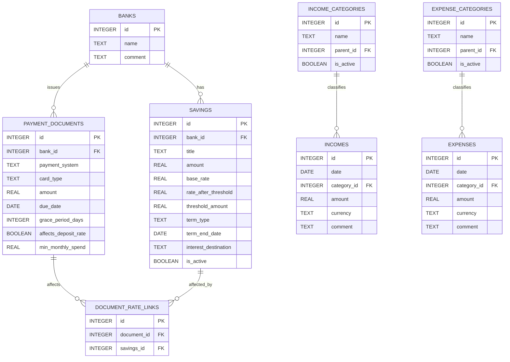

# Additional Materials for the Technical Specification

Below are all four requested deliverables: an ER diagram, a list of use cases, Rust migration examples with repository structure, and mockups for the new modules ("Savings", "Payment Documents").

---

## 1. ER Diagram of the Database

### 1.1. Textual (Mermaid) representation



### 1.2. Relationship summary

| Relationship | Cardinality | Description |
|---|---|---|
| `banks` → `savings` | 1 : N | One bank can have many savings deposits. |
| `banks` → `payment_documents` | 1 : N | One bank can issue many cards. |
| `income_categories` → `incomes` | 1 : N | One category groups many income transactions. |
| `income_categories` → `income_categories` | 1 : N | Self-referencing hierarchy (`parent_id`). |
| `expense_categories` → `expenses` | 1 : N | One category groups many expense transactions. |
| `expense_categories` → `expense_categories` | 1 : N | Self-referencing hierarchy (`parent_id`). |
| `payment_documents` → `document_rate_links` | 1 : N | A card can affect multiple savings rates. |
| `savings` → `document_rate_links` | 1 : N | A savings rate can be affected by multiple cards. |

### 1.3. Key constraints

- `document_rate_links` is a many-to-many junction table.
- A link is only valid if `payment_documents.bank_id = savings.bank_id` (enforced in the application layer, optionally via a trigger).
- `term_end_date` is `NULL` when `term_type = 'unlimited'`.
- `due_date` and `grace_period_days` are `NULL` for debit cards.
- `parent_id` is `NULL` for top-level categories.
- Amounts are stored as `REAL` (or `INTEGER` in minor units if precise decimal arithmetic is required; recommend `rust_decimal` for calculations).

---

## 2. Use Cases

### 2.1. Actors

- **User** — the primary actor (owner of the personal finance data).
- **System** — the application itself (automated processes: migrations, calculations, exports).

### 2.2. Use case list

| ID | Name | Actor | Description | Preconditions | Postconditions |
|---|---|---|---|---|---|
| UC-01 | Add income | User | Record a new income transaction with date, category, amount, currency, comment. | Category exists. | Income is saved to DB. |
| UC-02 | Edit income | User | Modify an existing income record. | Record exists. | Changes are saved. |
| UC-03 | Delete income | User | Remove an income record with confirmation. | Record exists. | Record is deleted. |
| UC-04 | Add expense | User | Record a new expense transaction. | Category exists. | Expense is saved. |
| UC-05 | Edit expense | User | Modify an existing expense record. | Record exists. | Changes are saved. |
| UC-06 | Delete expense | User | Remove an expense record with confirmation. | Record exists. | Record is deleted. |
| UC-07 | Filter transactions | User | Filter income/expense records by date, period, week, category. | — | Filtered list is displayed. |
| UC-08 | Manage income categories | User | Add, edit, delete, activate/deactivate income classifiers. | — | Classifier list is updated. |
| UC-09 | Manage expense categories | User | Add, edit, delete, activate/deactivate expense classifiers. | — | Classifier list is updated. |
| UC-10 | Manage banks | User | Add, edit, delete banks. | — | Bank list is updated. |
| UC-11 | Protect used entities | System | Prevent deletion of categories/banks used in transactions; show confirmation for cascade. | Entity is referenced. | Deletion blocked or cascaded after confirmation. |
| UC-12 | Add savings | User | Create a savings deposit with amount, base rate, threshold rate, threshold amount, term type, end date, bank, interest destination. | Bank exists. | Savings is saved. |
| UC-13 | Edit savings | User | Modify savings parameters. | Savings exists. | Changes are saved. |
| UC-14 | Delete savings | User | Remove a savings record with confirmation. | Savings exists. | Record is deleted (links removed). |
| UC-15 | Calculate savings interest | System | Compute base interest and potential income based on amount, rate, and term. | Savings exists. | Calculated values are displayed. |
| UC-16 | Add payment document | User | Create a card with payment system, type, amount, due date, grace period, bank, affects-rate flag, min monthly spend. | Bank exists. | Card is saved. |
| UC-17 | Link card to savings | User | Select savings (same bank) whose rate is affected by the card. | Card and savings exist in the same bank. | Link is saved in `document_rate_links`. |
| UC-18 | Validate same-bank link | System | Prevent linking a card to savings in a different bank. | — | Invalid link rejected with error message. |
| UC-19 | Edit payment document | User | Modify card parameters. | Card exists. | Changes are saved. |
| UC-20 | Delete payment document | User | Remove a card with confirmation; links are removed. | Card exists. | Record and links deleted. |
| UC-21 | Analyze finances | User | Select period and mode (income/expense/all); view summary by category with %, monthly amount, annual forecast, totals. | Transactions exist. | Report is displayed. |
| UC-22 | Export report | User | Export analysis to CSV/XLSX. | Report is generated. | File is saved. |
| UC-23 | Export full DB dump | User | Copy `data.db` (optionally ZIP with manifest) to chosen directory with timestamp. | DB exists. | Dump file is saved. |
| UC-24 | Export SQL dump | User | Generate `.sql` file with schema and data. | DB exists. | SQL file is saved. |
| UC-25 | Export module data | User | Export income/expenses/savings/cards/directories to CSV/XLSX with optional filters. | Data exists. | File(s) saved. |
| UC-26 | Import DB dump (optional) | User | Restore DB from `.db` or ZIP with schema compatibility check. | Valid dump exists. | DB is restored. |
| UC-27 | Search transactions | User | Search across income/expense records. | — | Matching records displayed. |
| UC-28 | Initialize application | System | On first launch, create DB and apply migrations. | DB absent. | DB ready. |
| UC-29 | Log operations | System | Write export, error, and audit logs to `%APPDATA%\FinanceApp\logs`. | — | Log files updated. |
| UC-30 | Switch display currency | User | Toggle display between RUB and USD. | — | Values re-rendered. |

### 2.3. Example scenario: UC-17 (Link card to savings)

1. User opens the "Payment Documents" module and selects a card.
2. User enables the flag "Can affect interest on deposits or accounts at the bank".
3. System queries savings where `bank_id` matches the card's `bank_id`.
4. System displays a multi-select list of eligible savings.
5. User selects one or more savings and confirms.
6. System validates that all selected savings belong to the same bank.
7. System inserts rows into `document_rate_links`.
8. System displays a success message.

### 2.4. Example scenario: UC-21 (Analyze finances)

1. User opens the "Analysis" module.
2. User selects mode ("Expense") and period (e.g., 01.11.2026 – 30.11.2026).
3. System aggregates expenses by category.
4. System computes for each category: amount in RUB and USD, % of total, monthly amount, annual forecast.
5. System displays the summary table with totals and special-category subtotal.
6. User optionally exports the report (UC-22).

---

## 3. Rust Migration Examples and Repository Structure

### 3.1. Workspace `Cargo.toml`

```toml
[workspace]
members = [
    "crates/core",
    "crates/db",
    "crates/ui",
    "crates/export",
    "crates/app",
]
resolver = "2"

[workspace.dependencies]
serde = { version = "1", features = ["derive"] }
serde_json = "1"
chrono = { version = "0.4", features = ["serde"] }
rust_decimal = { version = "1", features = ["serde"] }
thiserror = "1"
tracing = "0.1"
tracing-subscriber = "0.3"
```

### 3.2. `crates/db/Cargo.toml`

```toml
[package]
name = "db"
version = "0.1.0"
edition = "2021"

[dependencies]
rusqlite = { version = "0.31", features = ["bundled", "chrono", "serde_json"] }
refinery = { version = "0.8", features = ["rusqlite"] }
serde.workspace = true
chrono.workspace = true
rust_decimal.workspace = true
thiserror.workspace = true
tracing.workspace = true
```

### 3.3. Migrations (`crates/db/migrations/`)

Migrations are embedded via `refinery`. Files are named `V{n}__{description}.sql`.

**`V1__init_schema.sql`**

```sql
-- Banks
CREATE TABLE banks (
    id      INTEGER PRIMARY KEY AUTOINCREMENT,
    name    TEXT NOT NULL UNIQUE,
    comment TEXT
);

-- Income categories (hierarchical)
CREATE TABLE income_categories (
    id        INTEGER PRIMARY KEY AUTOINCREMENT,
    name      TEXT NOT NULL,
    parent_id INTEGER REFERENCES income_categories(id) ON DELETE RESTRICT,
    is_active INTEGER NOT NULL DEFAULT 1 CHECK (is_active IN (0, 1))
);

-- Expense categories (hierarchical)
CREATE TABLE expense_categories (
    id        INTEGER PRIMARY KEY AUTOINCREMENT,
    name      TEXT NOT NULL,
    parent_id INTEGER REFERENCES expense_categories(id) ON DELETE RESTRICT,
    is_active INTEGER NOT NULL DEFAULT 1 CHECK (is_active IN (0, 1))
);

-- Incomes
CREATE TABLE incomes (
    id          INTEGER PRIMARY KEY AUTOINCREMENT,
    date        TEXT NOT NULL,
    category_id INTEGER NOT NULL REFERENCES income_categories(id) ON DELETE RESTRICT,
    amount      TEXT NOT NULL,          -- decimal stored as TEXT for precision
    currency    TEXT NOT NULL DEFAULT 'RUB' CHECK (currency IN ('RUB', 'USD')),
    comment     TEXT
);
CREATE INDEX idx_incomes_date ON incomes(date);
CREATE INDEX idx_incomes_category ON incomes(category_id);

-- Expenses
CREATE TABLE expenses (
    id          INTEGER PRIMARY KEY AUTOINCREMENT,
    date        TEXT NOT NULL,
    category_id INTEGER NOT NULL REFERENCES expense_categories(id) ON DELETE RESTRICT,
    amount      TEXT NOT NULL,
    currency    TEXT NOT NULL DEFAULT 'RUB' CHECK (currency IN ('RUB', 'USD')),
    comment     TEXT
);
CREATE INDEX idx_expenses_date ON expenses(date);
CREATE INDEX idx_expenses_category ON expenses(category_id);
```

**`V2__savings.sql`**

```sql
CREATE TABLE savings (
    id                  INTEGER PRIMARY KEY AUTOINCREMENT,
    bank_id             INTEGER NOT NULL REFERENCES banks(id) ON DELETE RESTRICT,
    title               TEXT NOT NULL,
    amount              TEXT NOT NULL,
    base_rate           TEXT NOT NULL,
    rate_after_threshold TEXT,
    threshold_amount    TEXT,
    term_type           TEXT NOT NULL CHECK (term_type IN ('limited', 'unlimited')),
    term_end_date       TEXT,
    interest_destination TEXT NOT NULL CHECK (interest_destination IN ('reinvest', 'withdraw')),
    is_active           INTEGER NOT NULL DEFAULT 1 CHECK (is_active IN (0, 1)),
    CHECK (
        (term_type = 'limited' AND term_end_date IS NOT NULL)
        OR (term_type = 'unlimited' AND term_end_date IS NULL)
    )
);
CREATE INDEX idx_savings_bank ON savings(bank_id);
```

**`V3__payment_documents.sql`**

```sql
CREATE TABLE payment_documents (
    id                  INTEGER PRIMARY KEY AUTOINCREMENT,
    bank_id             INTEGER NOT NULL REFERENCES banks(id) ON DELETE RESTRICT,
    payment_system      TEXT NOT NULL CHECK (payment_system IN ('VISA', 'MasterCard', 'MIR')),
    card_type           TEXT NOT NULL CHECK (card_type IN ('debit', 'credit')),
    amount              TEXT NOT NULL,
    due_date            TEXT,
    grace_period_days   INTEGER,
    affects_deposit_rate INTEGER NOT NULL DEFAULT 0 CHECK (affects_deposit_rate IN (0, 1)),
    min_monthly_spend   TEXT,
    CHECK (
        (card_type = 'credit' AND due_date IS NOT NULL AND grace_period_days IS NOT NULL)
        OR (card_type = 'debit' AND due_date IS NULL AND grace_period_days IS NULL)
    )
);
CREATE INDEX idx_documents_bank ON payment_documents(bank_id);

CREATE TABLE document_rate_links (
    id          INTEGER PRIMARY KEY AUTOINCREMENT,
    document_id INTEGER NOT NULL REFERENCES payment_documents(id) ON DELETE CASCADE,
    savings_id  INTEGER NOT NULL REFERENCES savings(id) ON DELETE CASCADE,
    UNIQUE (document_id, savings_id)
);
CREATE INDEX idx_links_document ON document_rate_links(document_id);
CREATE INDEX idx_links_savings ON document_rate_links(savings_id);
```

**`V4__same_bank_trigger.sql`**

```sql
-- Enforce that a card can only affect savings within the same bank.
CREATE TRIGGER trg_document_rate_links_same_bank
BEFORE INSERT ON document_rate_links
FOR EACH ROW
BEGIN
    SELECT RAISE(ABORT, 'document and savings must belong to the same bank')
    WHERE (
        SELECT bank_id FROM payment_documents WHERE id = NEW.document_id
    ) <> (
        SELECT bank_id FROM savings WHERE id = NEW.savings_id
    );
END;
```

### 3.4. Domain models (`crates/core/src/models.rs`)

```rust
use chrono::NaiveDate;
use rust_decimal::Decimal;
use serde::{Deserialize, Serialize};

#[derive(Debug, Clone, Serialize, Deserialize)]
pub struct Bank {
    pub id: i64,
    pub name: String,
    pub comment: Option<String>,
}

#[derive(Debug, Clone, Serialize, Deserialize)]
pub struct IncomeCategory {
    pub id: i64,
    pub name: String,
    pub parent_id: Option<i64>,
    pub is_active: bool,
}

#[derive(Debug, Clone, Serialize, Deserialize)]
pub struct Income {
    pub id: i64,
    pub date: NaiveDate,
    pub category_id: i64,
    pub amount: Decimal,
    pub currency: Currency,
    pub comment: Option<String>,
}

#[derive(Debug, Clone, Copy, Serialize, Deserialize)]
#[serde(rename_all = "UPPERCASE")]
pub enum Currency { Rub, Usd }

#[derive(Debug, Clone, Copy, Serialize, Deserialize)]
#[serde(rename_all = "snake_case")]
pub enum TermType { Limited, Unlimited }

#[derive(Debug, Clone, Copy, Serialize, Deserialize)]
#[serde(rename_all = "snake_case")]
pub enum InterestDestination { Reinvest, Withdraw }

#[derive(Debug, Clone, Serialize, Deserialize)]
pub struct Savings {
    pub id: i64,
    pub bank_id: i64,
    pub title: String,
    pub amount: Decimal,
    pub base_rate: Decimal,
    pub rate_after_threshold: Option<Decimal>,
    pub threshold_amount: Option<Decimal>,
    pub term_type: TermType,
    pub term_end_date: Option<NaiveDate>,
    pub interest_destination: InterestDestination,
    pub is_active: bool,
}

#[derive(Debug, Clone, Copy, Serialize, Deserialize)]
#[serde(rename_all = "UPPERCASE")]
pub enum PaymentSystem { Visa, MasterCard, Mir }

#[derive(Debug, Clone, Copy, Serialize, Deserialize)]
#[serde(rename_all = "snake_case")]
pub enum CardType { Debit, Credit }

#[derive(Debug, Clone, Serialize, Deserialize)]
pub struct PaymentDocument {
    pub id: i64,
    pub bank_id: i64,
    pub payment_system: PaymentSystem,
    pub card_type: CardType,
    pub amount: Decimal,
    pub due_date: Option<NaiveDate>,
    pub grace_period_days: Option<i32>,
    pub affects_deposit_rate: bool,
    pub min_monthly_spend: Option<Decimal>,
}
```

### 3.5. Repository traits (`crates/db/src/repositories/mod.rs`)

```rust
pub mod banks;
pub mod categories;
pub mod incomes;
pub mod expenses;
pub mod savings;
pub mod documents;

use crate::error::DbError;

pub trait Repository<T, Id> {
    fn find_by_id(&self, id: Id) -> Result<Option<T>, DbError>;
    fn list(&self) -> Result<Vec<T>, DbError>;
    fn insert(&self, entity: &T) -> Result<Id, DbError>;
    fn update(&self, entity: &T) -> Result<(), DbError>;
    fn delete(&self, id: Id) -> Result<(), DbError>;
}
```

### 3.6. Example repository (`crates/db/src/repositories/savings.rs`)

```rust
use chrono::NaiveDate;
use rusqlite::{params, Connection, OptionalExtension};
use rust_decimal::Decimal;
use crate::error::DbError;
use core::models::{InterestDestination, Savings, TermType};

pub struct SavingsRepository<'a> {
    conn: &'a Connection,
}

impl<'a> SavingsRepository<'a> {
    pub fn new(conn: &'a Connection) -> Self { Self { conn } }

    pub fn find_by_id(&self, id: i64) -> Result<Option<Savings>, DbError> {
        let row = self.conn.query_row(
            "SELECT id, bank_id, title, amount, base_rate, rate_after_threshold,
                    threshold_amount, term_type, term_end_date, interest_destination, is_active
             FROM savings WHERE id = ?1",
            params![id],
            |r| {
                Ok(Savings {
                    id: r.get(0)?,
                    bank_id: r.get(1)?,
                    title: r.get(2)?,
                    amount: r.get::<_, String>(3)?.parse().unwrap_or_default(),
                    base_rate: r.get::<_, String>(4)?.parse().unwrap_or_default(),
                    rate_after_threshold: r.get::<_, Option<String>>(5)?
                        .and_then(|s| s.parse().ok()),
                    threshold_amount: r.get::<_, Option<String>>(6)?
                        .and_then(|s| s.parse().ok()),
                    term_type: match r.get::<_, String>(7)?.as_str() {
                        "limited" => TermType::Limited,
                        _ => TermType::Unlimited,
                    },
                    term_end_date: r.get::<_, Option<String>>(8)?
                        .and_then(|s| NaiveDate::parse_from_str(&s, "%Y-%m-%d").ok()),
                    interest_destination: match r.get::<_, String>(9)?.as_str() {
                        "reinvest" => InterestDestination::Reinvest,
                        _ => InterestDestination::Withdraw,
                    },
                    is_active: r.get(10)?,
                })
            },
        ).optional()?;
        Ok(row)
    }

    pub fn insert(&self, s: &Savings) -> Result<i64, DbError> {
        self.conn.execute(
            "INSERT INTO savings
                (bank_id, title, amount, base_rate, rate_after_threshold,
                 threshold_amount, term_type, term_end_date, interest_destination, is_active)
             VALUES (?1, ?2, ?3, ?4, ?5, ?6, ?7, ?8, ?9, ?10)",
            params![
                s.bank_id, s.title, s.amount.to_string(), s.base_rate.to_string(),
                s.rate_after_threshold.map(|d| d.to_string()),
                s.threshold_amount.map(|d| d.to_string()),
                match s.term_type { TermType::Limited => "limited", TermType::Unlimited => "unlimited" },
                s.term_end_date.map(|d| d.format("%Y-%m-%d").to_string()),
                match s.interest_destination {
                    InterestDestination::Reinvest => "reinvest",
                    InterestDestination::Withdraw => "withdraw",
                },
                s.is_active as i32,
            ],
        )?;
        Ok(self.conn.last_insert_rowid())
    }
}
```

### 3.7. Export module (`crates/export/src/lib.rs`)

```rust
use std::fs::File;
use std::io::Write;
use std::path::Path;
use rusqlite::Connection;
use zip::write::FileOptions;
use zip::ZipWriter;

pub fn export_full_db(conn_path: &Path, out_dir: &Path) -> anyhow::Result<std::path::PathBuf> {
    let ts = chrono::Local::now().format("%Y-%m-%d_%H-%M-%S");
    let out = out_dir.join(format!("data_{}.db", ts));
    std::fs::copy(conn_path, &out)?;
    Ok(out)
}

pub fn export_zip(conn_path: &Path, out_dir: &Path) -> anyhow::Result<std::path::PathBuf> {
    let ts = chrono::Local::now().format("%Y-%m-%d_%H-%M-%S");
    let out = out_dir.join(format!("backup_{}.zip", ts));
    let file = File::create(&out)?;
    let mut zip = ZipWriter::new(file);
    let opts: FileOptions = FileOptions::default().compression_method(zip::CompressionMethod::Deflated);

    zip.start_file("data.db", opts)?;
    zip.write_all(&std::fs::read(conn_path)?)?;

    let manifest = serde_json::json!({
        "created_at": chrono::Local::now().to_rfc3339(),
        "schema_version": 4,
        "app": "FinanceApp"
    });
    zip.start_file("manifest.json", opts)?;
    zip.write_all(serde_json::to_string_pretty(&manifest)?.as_bytes())?;
    zip.finish()?;
    Ok(out)
}

pub fn export_sql_dump(conn: &Connection, out_path: &Path) -> anyhow::Result<()> {
    let mut f = File::create(out_path)?;
    let tables = ["banks", "income_categories", "expense_categories",
                  "incomes", "expenses", "savings", "payment_documents",
                  "document_rate_links"];
    for t in tables {
        let mut stmt = conn.prepare(&format!("SELECT * FROM {}", t))?;
        let cols: Vec<String> = stmt.column_names().iter().map(|s| s.to_string()).collect();
        let mut rows = stmt.query([])?;
        while let Some(row) = rows.next()? {
            let mut vals = Vec::new();
            for i in 0..cols.len() {
                let v: rusqlite::types::Value = row.get(i)?;
                vals.push(match v {
                    rusqlite::types::Value::Null => "NULL".to_string(),
                    rusqlite::types::Value::Integer(n) => n.to_string(),
                    rusqlite::types::Value::Real(x) => x.to_string(),
                    rusqlite::types::Value::Text(s) => format!("'{}'", s.replace('\'', "''")),
                    rusqlite::types::Value::Blob(b) => format!("X'{}'", hex::encode(b)),
                });
            }
            writeln!(f, "INSERT INTO {} ({}) VALUES ({});",
                t, cols.join(", "), vals.join(", "))?;
        }
    }
    Ok(())
}
```

### 3.8. Directory layout

```
finance-app/
├── Cargo.toml
├── crates/
│   ├── core/
│   │   ├── Cargo.toml
│   │   └── src/
│   │       ├── lib.rs
│   │       ├── models.rs
│   │       ├── errors.rs
│   │       └── services/
│   │           ├── mod.rs
│   │           ├── analysis.rs
│   │           └── interest.rs
│   ├── db/
│   │   ├── Cargo.toml
│   │   ├── migrations/
│   │   │   ├── V1__init_schema.sql
│   │   │   ├── V2__savings.sql
│   │   │   ├── V3__payment_documents.sql
│   │   │   └── V4__same_bank_trigger.sql
│   │   └── src/
│   │       ├── lib.rs
│   │       ├── connection.rs
│   │       ├── error.rs
│   │       └── repositories/
│   │           ├── mod.rs
│   │           ├── banks.rs
│   │           ├── categories.rs
│   │           ├── incomes.rs
│   │           ├── expenses.rs
│   │           ├── savings.rs
│   │           └── documents.rs
│   ├── export/
│   │   ├── Cargo.toml
│   │   └── src/
│   │       ├── lib.rs
│   │       ├── csv_export.rs
│   │       └── xlsx_export.rs
│   ├── ui/
│   │   ├── Cargo.toml
│   │   └── src/
│   │       ├── lib.rs
│   │       ├── app.rs
│   │       ├── tabs/
│   │       │   ├── mod.rs
│   │       │   ├── income.rs
│   │       │   ├── expense.rs
│   │       │   ├── savings.rs
│   │       │   ├── documents.rs
│   │       │   ├── analysis.rs
│   │       │   └── directories.rs
│   │       └── widgets/
│   └── app/
│       ├── Cargo.toml
│       └── src/
│           └── main.rs
├── assets/
│   ├── icons/
│   └── i18n/
│       └── ru.ftl
└── installer/
    └── nsis/
        └── installer.nsi
```

---

## 4. Mockups for the New Modules

Below are textual/ASCII mockups. The design assumes a native GUI framework (`egui` or `iced`); layouts are described in terms of widgets and regions.

### 4.1. "Savings" module — list view

```
┌────────────────────────────────────────────────────────────────────────────────────────┐
│ [Income] [Expense] [Savings*] [Payment Documents] [Analysis] [Directories]             │
├────────────────────────────────────────────────────────────────────────────────────────┤
│ [ + Add ] [ ✎ Edit ] [ 🗑 Delete ] [ ⟳ Refresh ] [ ⤓ Export ]                          │
├────────────────────────────────────────────────────────────────────────────────────────┤
│ Filter: [ All banks ▼ ]  [ All statuses ▼ ]   Period: [ from ] – [ to ]   [ Apply ]  │
├────────────────────────────────────────────────────────────────────────────────────────┤
│  Bank        │ Title              │ Amount     │ Base % │ Threshold % │ Term      │ Status │
│──────────────┼────────────────────┼────────────┼────────┼─────────────┼───────────┼────────┤
│  Sberbank    │ "Nakopitelny"      │ 500 000 ₽  │ 8.50   │ 10.00       │ 12 mo     │ Active │
│  Tinkoff     │ "Pro"              │ 250 000 ₽  │ 7.00   │ 8.50        │ unlimited │ Active │
│  VTB         │ "Salary account"   │ 120 000 ₽  │ 6.00   │ —           │ unlimited │ Active │
│  Alfa        │ "Deposit 2026"     │ 300 000 ₽  │ 9.00   │ 11.00       │ 24 mo     │ Active │
├────────────────────────────────────────────────────────────────────────────────────────┤
│ Total: 1 170 000 ₽  |  Accrued interest (est. month): 6 750 ₽                          │
└────────────────────────────────────────────────────────────────────────────────────────┘
```

### 4.2. "Savings" module — edit dialog

```
┌─────────────────────────── Savings ───────────────────────────┐
│  Bank *            [ Sberbank ▼ ]                             │
│  Title *           [ Nakopitelny                ]             │
│  Amount *          [ 500 000.00          ] RUB                │
│                                                                │
│  Base rate *       [ 8.50    ] %                              │
│  Threshold rate    [ 10.00   ] %                              │
│  Threshold amount  [ 50 000.00 ] RUB (monthly spend)          │
│                                                                │
│  Term type *       (•) Limited   ( ) Unlimited                │
│  End date          [ 2027-11-18 📅 ]                          │
│                                                                │
│  Interest dest. *  (•) Reinvest   ( ) Withdraw to card        │
│                                                                │
│  Status            [x] Active                                 │
│                                                                │
│  Linked cards:  [ MasterCard •1234 (Sberbank) ]  [ + Link ]   │
│                                                                │
│                       [ Save ]  [ Cancel ]                    │
└────────────────────────────────────────────────────────────────┘
```

### 4.3. "Payment Documents" module — list view

```
┌────────────────────────────────────────────────────────────────────────────────────────────┐
│ [Income] [Expense] [Savings] [Payment Documents*] [Analysis] [Directories]                 │
├────────────────────────────────────────────────────────────────────────────────────────────┤
│ [ + Add ] [ ✎ Edit ] [ 🗑 Delete ] [ ⟳ Refresh ] [ ⤓ Export ]                              │
├────────────────────────────────────────────────────────────────────────────────────────────┤
│ Filter: [ All banks ▼ ] [ All systems ▼ ] [ All types ▼ ]                                  │
├────────────────────────────────────────────────────────────────────────────────────────────┤
│ Bank     │ System     │ Type    │ Amount      │ Due date   │ Grace │ Affects │ Min/mo    │
│──────────┼────────────┼─────────┼─────────────┼────────────┼───────┼─────────┼───────────│
│ Sberbank │ MasterCard │ debit   │ 120 000 ₽   │ —          │ —     │ 2 links │ 10 000 ₽  │
│ Tinkoff  │ VISA       │ credit  │ 300 000 ₽   │ 2026-12-25 │ 55 d  │ 1 link  │ 20 000 ₽  │
│ VTB      │ MIR        │ debit   │ 45 000 ₽    │ —          │ —     │ —       │ —         │
│ Alfa     │ VISA       │ credit  │ 200 000 ₽   │ 2026-12-10 │ 100 d │ 1 link  │ 15 000 ₽  │
├────────────────────────────────────────────────────────────────────────────────────────────┤
│ Total balance/limits: 665 000 ₽                                                            │
└────────────────────────────────────────────────────────────────────────────────────────────┘
```

### 4.4. "Payment Documents" module — edit dialog

```
┌──────────────────── Payment document ────────────────────┐
│  Bank *            [ Tinkoff ▼ ]                         │
│  Payment system *  [ VISA ▼ ]                            │
│  Card type *       ( ) Debit   (•) Credit                │
│  Amount *          [ 300 000.00      ] RUB               │
│                                                          │
│  Due date          [ 2026-12-25 📅 ]                     │
│  Grace period      [ 55   ] days                         │
│                                                          │
│  [x] Can affect interest on deposits/accounts            │
│                                                          │
│  Linked savings (same bank):                             │
│    [x] "Pro" (7.00% → 8.50%)                             │
│    [ ] "Invest" (6.50% → 7.00%)                          │
│                                                          │
│  Required min monthly spend  [ 20 000.00 ] RUB           │
│                                                          │
│                  [ Save ]  [ Cancel ]                    │
└──────────────────────────────────────────────────────────┘
```

### 4.5. "Analysis" module — extended with savings/cards info (mockup)

```
┌──────────────────────────────────────────────────────────────────────────────────────┐
│ [Income] [Expense] [Savings] [Payment Documents] [Analysis*] [Directories]           │
├──────────────────────────────────────────────────────────────────────────────────────┤
│ Mode: (•) Expense  ( ) Income  ( ) All   Period: [ 2026-11-01 ] – [ 2026-11-30 ] [ Analyze ] │
├──────────────────────────────────────────────────────────────────────────────────────┤
│  Category            │   RUB        │   USD      │  %    │  /month    │  Forecast/yr │
│──────────────────────┼──────────────┼────────────┼───────┼────────────┼──────────────│
│  Large purchase      │  60 000.00   │  2 253.10  │ 38.56 │  2 253.10  │  60 000.00   │
│  Car                 │  28 896.30   │  1 085.10  │ 18.57 │  1 085.10  │  28 896.30   │
│  Groceries           │  22 146.53   │   831.64   │ 14.23 │    831.64  │  22 146.53   │
│  Apartment           │   9 609.00   │   360.83   │  6.18 │